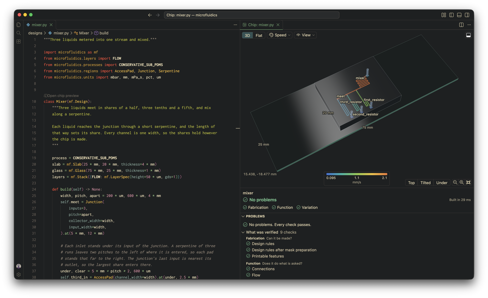

# Microfluidic Device Design Tool 🧑‍🔬

`microfluidics` is a design tool for microfluidic chips made by soft lithography. A typed Python class describes the chip’s geometry, operating conditions, and requirements. The Rust kernel solves the flow network, tunes design parameters to meet those requirements, and checks the layout against a fabrication process. It exports photomasks in GDSII and DXF with a verification report for each process.

The VS Code extension shows the chip beside its Python source. Here the channels of a three-inlet mixer are coloured by flow speed.



## Install the package

Install the package in a CPython 3.11 or newer environment.

```sh
pip install microfluidics
```

## Try a design

The mother machine has three independent flow channels lined with growth trenches. The design uses two mask layers, one for the shallow trenches and one for the deeper channels. It specifies that medium in each channel must be replaced within one second.

First, download the `mother_machine.py` file from GitHub:

```sh
curl -fLO https://raw.githubusercontent.com/marpaia/microfluidics/master/designs/mother_machine.py
```

Use the `microfluidics` CLI to check the design and generate its fabrication files.

```sh
# Check channel connectivity and the layout against the articulated fabrication limits.
microfluidics check mother_machine.py

# Predict the residence time in each channel and check it against the one-second limit.
microfluidics solve mother_machine.py

# Generate a two-layer GDSII file, one DXF per layer, and a fabrication traveler.
microfluidics export mother_machine.py out
```

The export writes the following files under `out/cosinc-su8-pdms/`.

| File | Contents |
| --- | --- |
| `masks/chip.gds` | Both mask layers in one GDSII layout |
| `masks/mask_1_trench.dxf`, `masks/mask_2_flow.dxf` | Separate drawings for the trenches and flow channels |
| `masks/preview.svg` | A preview of both layers that opens in a browser |
| `TRAVELER.md` | Fabrication steps by layer, alignment marks, and hole positions |
| `REPORT.md` | Verification results for the COSINC process |

Run `microfluidics guide` for the Python API, or explore the [design examples](https://github.com/marpaia/microfluidics/blob/master/docs/examples.md) and [VS Code viewer](https://github.com/marpaia/microfluidics/blob/master/docs/viewer.md). The alpha uses a steady laminar flow model that still awaits validation against fabricated chips. The [model and process limitations](https://github.com/marpaia/microfluidics/blob/master/docs/limitations.md) describe the assumptions behind the checks.

## License

[MIT](LICENSE)
