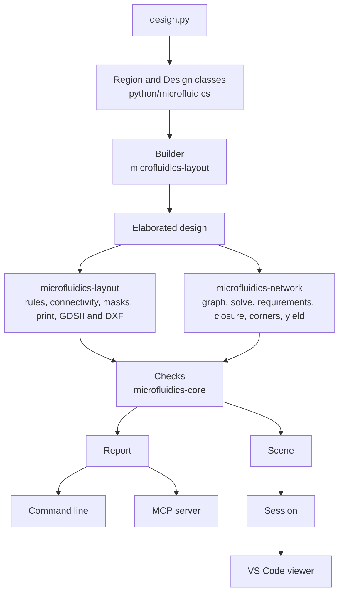

# Architecture

How the repository is organised and how a design passes through it. Read this before changing the engine, the Python package or the extension.

## Layout

| Path | Contents |
| --- | --- |
| `python/microfluidics` | The Python package: `Region` and `Design`, quantities, the standard regions, the command line, the session's host, and the MCP server |
| `crates/microfluidics-py` | The engine as a Python extension module (`microfluidics._engine`). Bindings only |
| `crates/microfluidics-network` | Function: the flow graph, its solution, requirements, closure, corners and yield, verification, benchmarks, the scene and the session |
| `crates/microfluidics-layout` | Geometry: the builder, the chip, processes and their fabs, the rule check, connectivity, routing, masks, the print model, GDSII and DXF, hand-off sheets, and wafers |
| `crates/microfluidics-core` | Quantities, checks, hashes and the data types shared between crates |
| `editors/vscode` | The VS Code extension |
| `designs/` | Four designs, their tuned values, and a wafer |
| `benchmarks/` | Tasks against which a design can be scored |
| `processes/` | Fabrication processes, one for each fab |
| `tests/` | The Python tests and the captured results they compare against |

Crate dependencies run one way: `core` ← `layout` ← `network` ← `py`.

## How a design is processed

1. **Authoring.** `Design.elaborate` runs the design's `build`. Each assignment to an attribute names the thing assigned and sends it to the builder with the source line that made it.
2. **Building.** `Builder` in `microfluidics-layout` is the only place a design is assembled, and every rule about what a design may be is there. Things are known by path (`feed.trunk_width`, `lane[2].left[17]`). The result is an `Elaborated` design: the chip's geometry, its stated edges, its operating conditions, its requirements and its tunable parameters.
3. **Checking.** `microfluidics-layout` checks the chip against the process and prepares masks. `microfluidics-network` extracts and solves the flow graph and evaluates requirements. `verify` runs every check in order and produces a `Report`.
4. **Reporting.** Every verdict is a `Check` from `microfluidics-core`. The command line, the MCP server and the session all present the same checks.

A design is rebuilt from source for every closure trial and every session build. Overrides replace parameter values by path as the builder runs, which is how tuned values and viewer trials take effect without changing source.

## Conventions

- **The bindings state no rules.** `microfluidics-py` converts values and forwards calls. Behaviour belongs in the Rust crates or the Python package.
- **Standard regions are ordinary regions.** They live in `python/microfluidics/regions/`, one per file, and the engine does not distinguish them from a region written beside a design.
- **One command table.** `python/microfluidics/commands.py` defines each command once. The command line, the MCP server and the session's `run` all use it.
- **Source is never rewritten.** Tuned values go to `<design>.tuned.toml` and waivers to `<design>.waivers.toml`.
- **Library code returns errors.** The workspace lints deny `unwrap`, `expect` and `panic`; tests opt out per file. `unsafe` is forbidden everywhere except the bindings crate, where PyO3's macros need it and the crate's own code is denied it.
- **Rust imports** follow the layout that `scripts/check_imports.py` checks.

## The viewer boundary

The extension host (`editors/vscode/src/extension.ts`) starts a [session](../protocols/session.md) and relays its messages. The webview (`editors/vscode/src/viewer/`) draws a [scene](../formats/scene-v4.md) and knows nothing else about chips. Anything a viewer needs must therefore be in the scene.
