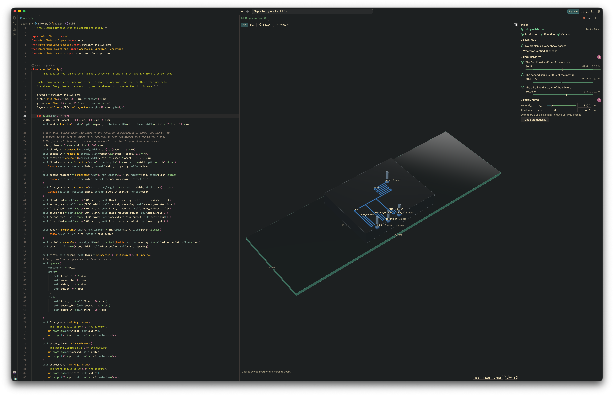

# Viewer

The VS Code extension in [`editors/vscode`](../editors/vscode) shows a design's chip beside its source and rebuilds it on save. This page covers installing it and what each part of the preview does. The preview draws a [scene](formats/scene-v4.md) that a [session](protocols/session.md) keeps current; the viewer itself knows nothing about chips beyond drawing that document.

<p align="center">
  
</p>

## Install

```console
cd editors/vscode
npm install
npm run package          # writes microfluidics-0.1.0.vsix
code --install-extension microfluidics-0.1.0.vsix
```

Open a design and run **Microfluidics: Open Preview**. An editor that holds a design also has an "Open chip preview" lens above the design's class, a button in its title bar, and the chip's status in the status bar.

The session runs in the Python that the `microfluidics.python` setting names. When the setting is empty, the extension uses the workspace folder's `.venv`, then the interpreter the Python extension has selected, then `python3`. If the session cannot start, or it exits, the preview says why in place of the chip.

## The chip

The left side of the preview draws the chip.

- **3D** draws the device the design states: the glass, the PDMS slab bonded at its middle, the channels as dyed liquid at their depths, and a hole of the process's punch diameter through the slab at each access point.
  - Drag to orbit, as far as beneath the glass. Shift-drag, or drag with the other button, to pan. Scroll to zoom about the pointer.
  - **Top**, **Tilted** and **Under** set the camera. The arrow keys orbit, and with Shift pan. `+`, `-`, `0` and `F` zoom and fit.
  - **Depth**, in the View menu, exaggerates channel height by up to a hundred times, so that a 20 um channel in a 4 mm slab is visible from the side. Nothing else changes, and the view is labelled as not to scale.
  - Seen from straight above or below, the view shows a scale bar. Tilted, the glass and the slab carry their dimensions along their nearer edges.
- **Flat** draws the layout alone from above, for work at mask level. Drag to pan and scroll to zoom.
- **Labels.** Each instance carries its name, and each access point shows what is applied there. A row of instances too close to label individually gets one label (`lane[0..7]`), and zooming in labels what is inside an instance. The pointer's position on the chip is shown at the lower left.
- **Selection.** A click selects the outermost thing under the pointer, and the panel shows the region it is an instance of, its size, the parameters it was built with, and what flows through it. Clicking again goes one level inside. `F` centres the selection and `Escape` clears it.
- **Source links.** Selecting something scrolls the editor to the line that made it and highlights the line, without moving keyboard focus. Placing the cursor on a line outlines what that line made.
- **Colour.** The colour menu switches between layer colours and flow rate, shear, velocity or pressure. Outside layer colouring, a legend gives the scale (logarithmic when values span more than fifty times), and an arrowhead at each channel's downstream end shows the flow direction.

The buttons at the lower right zoom and fit the whole chip. The View menu hides layers and labels.

## The panel

The panel reports whether the design works.

- **Summary.** The design's name and its status: "No problems", or a count. Under it, one mark for each question verification asks: Fabrication, Function and Variation. A mark links to that question's problems.
- **Problems.** Everything that keeps the design from passing, grouped by question. Each entry gives what is wrong, the check that found it, and what it concerns. An entry about something on the chip carries the number drawn there, and choosing it selects that thing and shows its line. "Go to source" and "Zoom to it" appear on a row under the pointer or the keyboard. Many problems from one check are folded after the first four. A check that could not run is listed with the reason. "What was verified" expands to every check.
- **Requirements.** For each requirement: the value measured as drawn, the allowed range, and one line that shows both, with a mark at each measured value and a whisker over the range the values cover across the process corners. The whisker turns red where it leaves the allowed range.
- **Selection.** Shown above the rest while something is selected.

Problems are also editor diagnostics: they appear in the Problems panel, as squiggles on the lines that made what they concern, and as a count in the status bar.

## Parameters

Each tunable parameter has a slider and a field, with a mark at the saved value. Changing one builds the design with that value as a trial. Nothing is written.

While trial values are active, a bar stays at the foot of the panel. **Keep** saves them to the tuned-values file beside the design. **Discard** returns to the saved values. **Tune automatically** runs [closure](verification.md#closure), which starts from the design as written and saves what it finds.

## A build that fails

When the design does not build, the preview shows the error with a link to the line and to the log. It keeps the last chip and its results, dimmed, until the design builds again.

## Layout

The preview measures its own width and height in units of the editor's font, so editor zoom counts the same as pixel size, and arranges itself to fit:

| Space | Arrangement |
| --- | --- |
| Wide | The chip with the panel at its right. The divider can be dragged, or moved with the arrow keys; a double click restores its default position |
| Narrow and tall, such as beside the code in a window of ordinary size | The chip with the panel beneath it |
| Too small for both | The chip, with the design's status on one line at its foot. The line opens the panel over the chip |
| Smaller still | The chip and a status mark |

The View menu pins the panel to the right, beneath, or hidden. Controls over the chip that do not fit collapse in steps, first to icons and then into one menu. A view that showed the whole chip shows the whole chip again after a resize; a view that had been moved keeps the same point at its centre.

Every list is one Tab stop: the arrow keys move through it and Enter acts on a row. Colours, icons and sizes are the editor's own in its dark, light and high-contrast themes. A preview that was open when the window reloaded opens again on its design.

## Implementation

The panel is written with Preact and the device is drawn with three.js, both bundled into the extension. The flat layout, and the labels and marks over either view, are drawn on a plain canvas. Where 3D cannot be drawn, the chip is drawn flat. [Testing](development/testing.md#vs-code-extension) covers the extension's tests.
