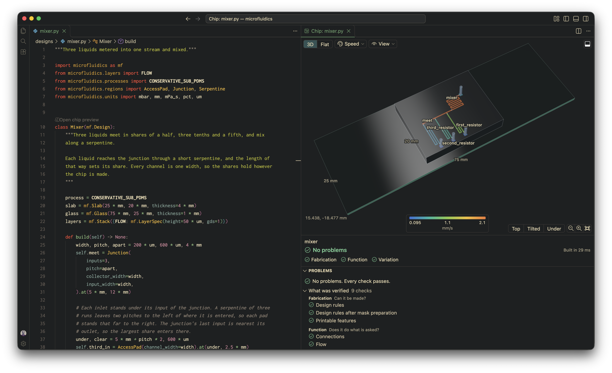

# Microfluidics for VS Code

Preview a microfluidic chip beside its Python design. Colour the channels by flow speed or pressure, select a channel to jump to the line that defines it, and see which fabrication checks pass as you edit.



## Open your first preview

Open a folder in VS Code. In its terminal, create a virtual environment with CPython 3.11 or newer and install the design package.

**macOS or Linux**

```sh
python3 -m venv .venv
.venv/bin/python -m pip install microfluidics
```

**Windows (PowerShell)**

```powershell
py -3 -m venv .venv
.\.venv\Scripts\python.exe -m pip install microfluidics
```

Save the [example mixer design](https://raw.githubusercontent.com/marpaia/microfluidics/master/designs/mixer.py) as `mixer.py` in that folder and open it. In the Command Palette, run **Microfluidics: Open Preview**. Select a channel to find its definition, or edit the design and save to rebuild the preview.

The extension finds the workspace’s `.venv` automatically. To use an existing installation, set `microfluidics.python` in VS Code settings to the path of the Python executable that has `microfluidics` installed.

The [viewer guide](https://github.com/marpaia/microfluidics/blob/master/docs/viewer.md) covers mask layers, flow colours, verification results, and tuning design parameters.
